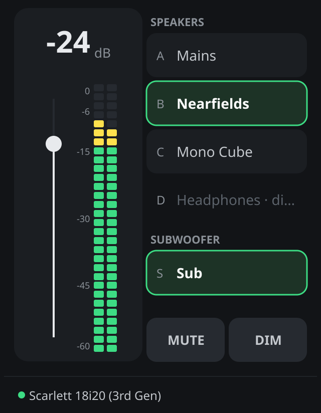
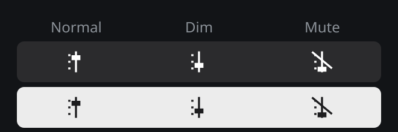

# Monitor Controller 

[](https://github.com/sebastianrau/focusrite-mackie-control/actions/workflows/ci.yml)
[](https://github.com/sebastianrau/focusrite-mackie-control/releases/latest)

A monitor controller for Focusrite Scarlett interfaces: switch between your
speakers, set the monitor volume, dim and mute, from your desktop, a control
surface, a Stream Deck or any OSC app.

<p align="center"></p>

## Features

- **Speaker switching** for up to four speaker pairs and a subwoofer.
  Exclusive speakers turn the others off; the sub is switched on its own.
- **Volume, Dim and Mute** for all assigned outputs, with an adjustable dim
  amount.
- **Level meter** for the selected speakers.
- **Many ways to control it, all in sync:** the app window, the menu bar,
  a Mackie Control (MCU) surface, a Stream Deck, OSC apps such as TouchOSC,
  and the monitor buttons on the interface itself. Press Dim on the
  interface and it lights up everywhere else.
- **Settings apply at once:** no restart after changing the configuration.

Tested with the Scarlett 4i4 (3rd Gen) and Scarlett 18i20 (3rd Gen).

## Quick start

### Requirements

- A Focusrite Scarlett interface and **Focusrite Control** running on the
  same computer. The app talks to the interface through Focusrite Control.
- Optional: a Mackie Control compatible surface, a Stream Deck with a MIDI
  plugin, or an OSC app.

### Install

Download the archive for your system from the
[latest release](https://github.com/sebastianrau/focusrite-mackie-control/releases/latest):

| System | Archive | Install |
| ------ | ------- | ------- |
| macOS (Apple silicon) | `…_darwin_arm64.zip` | Unpack and move **Monitor Controller** to *Applications*. |
| macOS (Intel) | `…_darwin_amd64.zip` | Same as above. |
| Windows | `…_windows_amd64.zip` | Unpack and start **Monitor Controller.exe**. |
| Linux | `…_linux_amd64.tar.xz` | Unpack and run `sudo make install` (or `make user-install` for your account only). |

The app is not signed with an Apple or Microsoft developer certificate, so
the system asks once before the first start. On Windows, confirm the
SmartScreen prompt with *More info → Run anyway*. On macOS, see below.

### First start on macOS

Downloaded apps carry a quarantine flag, and macOS only opens apps from
unknown developers after you confirm. Start Monitor Controller once; when
macOS says it cannot verify the app:

1. Open *System Settings → Privacy & Security*.
2. Scroll to *Security*, click **Open Anyway** next to Monitor Controller and
   confirm.

Or remove the quarantine flag in Terminal:

```sh
xattr -dr com.apple.quarantine "/Applications/Monitor Controller.app"
```

Releases up to 0.4.0 lack a complete bundle signature, so macOS reports them
as *damaged* instead of offering *Open Anyway*. The `xattr` command above
fixes that too.

### First start

1. Start Focusrite Control and connect the interface.
2. Start Monitor Controller. Focusrite Control asks you to allow the new
   remote device **Monitor Controller**: allow it.
3. With no interface configured yet, the app takes the first one it finds
   and assigns its stereo outputs in order: outputs 1–2 to speaker A, 3–4 to
   B, 5–6 to C, 7–8 to D and 9–10 to the sub. You can change this in the
   [Configuration](#configuration) window.

The app controls the gain, mute and name of the assigned outputs.

## Using it

### Main window

- **Channel strip** (left): the volume in dB, with *muted* or *dimmed* below
  it when active, the volume fader and the level meter.
- **Speakers** (right): click a speaker to switch it on or off. The active one
  is outlined in green. Disabled speakers are shown grey.
- **MUTE** and **DIM**: red and yellow when on.
- **Status line**: the connected interface. A yellow dot means Focusrite
  Control runs but the interface is missing; a grey dot means Focusrite
  Control is not reachable. The controls are locked until both are there.

Closing the window keeps the app running in the menu bar.

### Menu bar

The menu bar icon shows the monitor state at a glance:

<p align="center"></p>

Its menu has **Show**, **Dim**, **Mute**, **Configuration** and **Exit**. On
macOS the app has no Dock icon; it lives in the menu bar.

### Speakers, volume, Dim and Mute

- **Exclusive speakers:** selecting an exclusive speaker turns the other
  speakers off. Non-exclusive speakers can play together; selecting one turns
  only the exclusive speakers off.
- **Volume** applies to all enabled outputs, from −127 dB to 0 dB.
- **Dim** lowers the volume by the dim amount (20 dB by default).
- **Mute** mutes all outputs.
- **The meter** shows the levels Focusrite Control reports for the first
  selected speaker, before the volume is applied.

## Configuration

Open **Configuration** from the menu bar. **Save** applies the changes at
once; only the connection whose settings changed reconnects.

| Section | Settings |
| ------- | -------- |
| **Monitor Controller** | Dim amount; per speaker *Disabled* and *Exclusive*. |
| **Midi** | MIDI input and output port, the fader channel, and the keys for Mute, Dim and each speaker. |
| **Focusrite** | The interface, and which stereo output each speaker uses. The monitor Mute and Dim controls of the interface are linked automatically. |
| **OSC** | OSC server on/off, its port, access from other devices, and targets that always receive the state. |

## Control surfaces and Stream Deck

Select the MIDI input and output ports under **Configuration → Midi**. For a
Stream Deck, create two virtual MIDI ports (on macOS: IAC Driver buses in
*Audio MIDI Setup*), connect your Stream Deck MIDI plugin to them, and import
the profile and icon pack from [`streamdeck/`](streamdeck/).

Default mapping, matching the Stream Deck profile:

| Function | MCU control |
| -------- | ----------- |
| Volume | Fader 1 |
| Mute | Mute 1 |
| Dim | Solo 1 |
| Speaker A–D | Trim, Touch, Write, F4 |
| Sub | Read |

Every assignment can be changed under **Configuration → Midi**. Pressing the
select button of the volume fader moves the fader to the current volume.

## OSC and TouchOSC

The app runs an OSC server on UDP port 9000, reachable from this computer
only unless you allow other devices. Any OSC client can switch speakers, set
volume, Dim and Mute, and receive the state, the speaker names and the meter.

- Address space and examples: [docs/osc.md](docs/osc.md)
- Ready-made TouchOSC layout and setup: [examples/touchosc](examples/touchosc/)

## Troubleshooting

| Symptom | What to check |
| ------- | ------------- |
| macOS: *Monitor Controller is damaged* or *cannot be opened* | Remove the quarantine flag, see [First start on macOS](#first-start-on-macos). |
| Status *No Focusrite Control connection* | Focusrite Control must run on the same computer. The app retries every few seconds. |
| Status *No device connected* | The interface is off or not selected under **Configuration → Focusrite**. |
| Nothing happens on the interface | Allow **Monitor Controller** as a remote device in Focusrite Control. |
| Control surface or Stream Deck does not react | The MIDI ports under **Configuration → Midi** must exist and must not be *none*. The app reconnects when the ports appear. |
| OSC client gets no updates | Add the client as a target, or let it send `/monitor/subscribe`. Clients on other devices need *Allow other devices*. |
| OSC port in use | Another program uses the port: choose another one under **Configuration → OSC**. |

**Logs:** the app logs to stderr. On macOS, start it from a terminal to see
them, with more detail when `MONITOR_CONTROL_LOG=debug` is set:

```sh
MONITOR_CONTROL_LOG=debug "/Applications/Monitor Controller.app/Contents/MacOS/monitor-control"
```

## Settings file

The settings are a YAML file in your configuration folder:

| System | Path |
| ------ | ---- |
| macOS | `~/Library/Application Support/Monitor-Controller/monitor-controller.yaml` |
| Windows | `%AppData%\Monitor-Controller\monitor-controller.yaml` |
| Linux | `~/.config/Monitor-Controller/monitor-controller.yaml` |

Files from 0.1.x are converted on first start. A file that cannot be read is
renamed to `monitor-controller.yaml.broken`, and the app starts with
defaults. To try something without touching your settings, start the app
with `-config <file>`.

## Development

Requires Go 1.25+ and a C compiler (Fyne and the MIDI driver use cgo). On
Linux, also install `libgl1-mesa-dev xorg-dev libwayland-dev libxkbcommon-dev wayland-protocols libasound2-dev`.

```sh
make run          # run from source
make test         # all tests with the race detector
make lint         # golangci-lint
make package      # release archive for this system in dist/
make screenshots  # regenerate the images in docs/images
make help         # all targets
```

CI builds and tests on macOS, Windows and Linux. Pushing a tag (for example
`0.4.0`) builds the archives for all systems and publishes a GitHub release.

### Architecture

```
  Focusrite Control ── focusrite.Client ── focusrite.Adapter ─┐
                                                              │ commands
  MCU / Stream Deck ── mcu.MidiSurface ─── mcu.Adapter ───────┤
                                                              │
  OSC clients ──────────────────────────── osc.Adapter ───────┼──────────► controller ──► config.Store
                                                              │ ◄──────────     │
  Window and menu bar ──────────────────── ui.App ────────────┘  snapshots      │
                                                                                └─ domain (state and rules)
```

| Package | Role |
| ------- | ---- |
| `internal/domain` | The state and every rule as pure functions: exclusive speakers, dim, volume limits, meter source. |
| `internal/controller` | Applies commands one at a time on a single goroutine and publishes each new state as a snapshot. A slow subscriber only gets the latest snapshot and never blocks the others. |
| `internal/focusrite` | Client and adapter for Focusrite Control; `protocol` is its XML protocol, tested with real messages from the 18i20 and 4i4. |
| `internal/mcu` | MIDI connection and adapter for Mackie Control surfaces. |
| `internal/osc` | OSC codec, server and adapter; `touchosc` generates the TouchOSC layout (`cmd/touchosc-layout`). |
| `internal/ui` | The Fyne window, menu bar and Configuration window. |
| `internal/config` | Settings file, migration and saving. |
| `cmd/monitor-control` | Wires everything together and restarts connections when settings change. |

The adapters translate between snapshots and devices: they send only what
changed and turn device input into commands.

## License

See [LICENSE.md](LICENSE.md).
